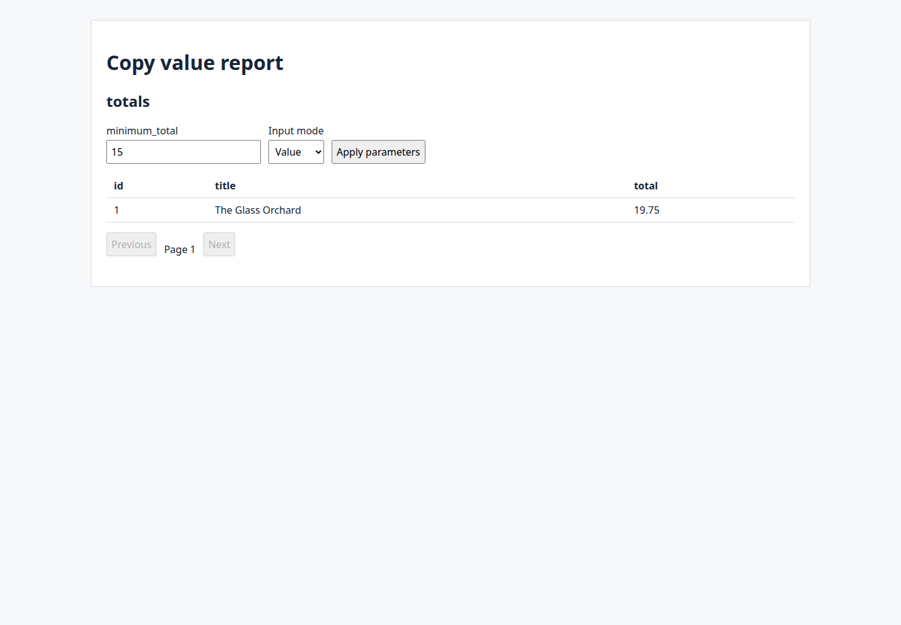

# Library Catalog: fresh Studio UI verification

This is **WP03 Library-scope proof**, not the final mission verdict or its two
complete clean cycles. The cold Library was authored through Studio and its
business rows through generated visitor forms. A separately identified supplied
raw SQLite input challenged quoted identifiers and 200/201 lookup behavior.

Validated application/test code: `9ef6b1781e12da82bf00e89f6d7dd6c6b0580298`.
The documentation commit is separate from this tested code. The canonical head
capture at `b133849a7158bedb3f152a7f3280d636e1f6cf99` ran 505 tests with zero failures, errors
or skips in 220.83 seconds wall time. Its invalid earlier baseline remains
unverified; the actual positive JUnit was inspected independently of that comparison.
This later documentation-only correction does not change application/test code. The [summary](library.json)
contains source, test and fixture provenance, exact synthetic rows and scoped results;
[retained result facts](library.results.json) distinguish captured outputs from
assertions verified by the exact hashed passing test;
[retained red observations](library.red.json) identify the defects before repair.

## Observed Library journey

1. A fresh private Workspace and New Project wizard created authors, books,
   book_authors, copies and loans. Schema controls selected integer IDs and FKs,
   ordered `(book_id, author_id)` primary key, unique catalog code/barcode,
   restrict relationships, nullable dates and TEXT decimal(12,2). Read-only model
   and SQLite observers checked the resulting declarations and ordered keys.
2. The wizard's completed Page/Form/Control objects stayed editable. Normal
   Properties configured relationship labels and named confirmations; Queries and
   Form construction authored two independent grouped reports. No project model,
   direct-command write or generated-source patch supplied a missing UI setting.
3. Generated forms saved the descriptor's three authors, three books, three
   associations, three copies and two loans. Exact before/after observers checked
   missing required date, excessive decimal scale, duplicate association,
   catalog/barcode conflict, canceled edits and restrict deletion of a loaned copy
   and associated book. Each rejection left all business rows unchanged.
4. Editing association `(1,2)` to `(3,2)` preserved the neighbor `(1,1)`; attempting
   to change the moved tuple into `(1,1)` failed atomically. UI editing restored
   `(1,2)`, and all rows matched the literal descriptor again.
5. The author report left-joined authors to book_authors, counted distinct book IDs,
   and returned 2/1/0. The separate books/copies report returned exact decimal
   totals 19.75/10.00/0.00 without authorship fan-out. Its runtime minimum 15
   returned only book1. C4 for book2 changed its total to 16.25 after Add, 20.00
   after Edit, and 10.00 after Delete; threshold membership changed accordingly.
   A nullable-cost copy left its zero-child total unchanged and was removed.
6. A supported SQLite backup of the UI-authored database became a declared supplied
   input. Existing-database inspection/review and Cancel left its bytes and rows
   unchanged and preserved the active Library database.
7. A fourth author named Mara Vale produced a separate explicit oracle (author1
   still count2, author4 initially count0). The visitor selected the distinguished
   author4 option and saved `(book3, author4)`; author1 and the original tuples were
   unchanged. The new author's count became1. UI deletion of the temporary
   association/author restored every original row.



## Supplied input variant and generic repair

The independent raw input declared two quoted table names (`shelf "labels"` and
`book "notes"`), the column `copy title`, 200 keyed parents and two identical
`Same label` names. It contained no Studio model. Its hash was recorded before
connection, and inspection did not change it. The wizard imported it, normal
Properties selected its lookup label, and ordinary Generate/build/start controls
produced its visitor app.

All 200 options were available. The visitor selected key2 and saved a child; a
read-only observer verified the exact quoted column value and parent key2. After
saving parent201 through its generated form, child Add displayed the explicit
200-option diagnostic instead of a truncated form; before/after rows were equal.

Before repair, differently keyed choices shared the same bare label, and a 201-row
lookup's useful service error was replaced by a generic key/database error. The
coordinated WP07 ownership exception changed only generator `record/service.template`,
`templates/base/index.ts` and the existing Record runtime regression. Duplicate
labels now carry the physical key field/value; unique literal labels are reserved
so an existing suffix-like name cannot collide with a generated choice. Values
remain stable. Only the typed lookup-bound error crosses the page boundary;
unknown errors keep the generic safe message.

The emitted-runtime regression independently saves the second duplicate key,
checks unchanged neighboring rows, exercises 200/201, verifies a literal suffix
collision, and checks that a private-looking unknown error is not disclosed.
No fixture-name production branch, lookup browser or composite lookup widget was added.

## Reproduce and limits

Use pinned Node/npm, scripts-denied acquisition, native verification and the
[documented build procedure](../../development/release.md), then:

```sh
npx --no-install playwright test tests/e2e/acceptance/library.spec.ts --workers=1 --retries=0
npx --no-install vitest run packages/generator/tests/record/runtime.test.ts
```

Finish shared Studio/generator builds before starting browser consumers. Tests use
fresh private owner configurations, roots, ports and browser contexts, disable
traces, observe SQLite read-only, and stop their own children. Raw databases,
credentials, owner config, identities and private logs are not committed.

Earlier harness failures remain private retained attempts; they include wrong
scalar-property/parameter defaults, missing new-record mode from guessed URLs,
unconfigured Grid lookup labels, exact confirmation/button assumptions and missing
semantic readiness waits. One later attempt was infrastructure-invalidated when a
shared Studio rebuild overlapped the next owned owner's startup; it is not a pass.
The original missing-Vitest baseline remains unverified, not a product failure.

This proof covers T011–T015 and the Library schema, record, report and lookup portions
of acceptance. Cross-project draft preservation, complete parent-filter navigation,
security/direct-handler matrices, migration/recovery, regeneration/export,
performance and the final two full clean cycles remain separate mission work.
Local validation does not assert hosted success or independent review approval.
