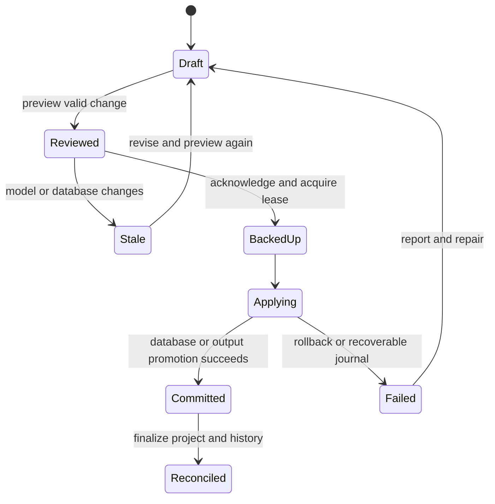

# Canonical model and invariants

All IDs are opaque stable strings independent of names/paths. Physical names are explicit; renames preserve IDs. Persistent schemas are versioned with supported upgrade functions and refusal of unknown newer versions. Server input is runtime-validated.

## Entities

| Entity | Essential fields and relationships |
|---|---|
| Project | id, formatVersion, revision, name, target, connectionRefs, schema, queries, pages, policies, outputConfig, extensionContracts |
| Connection | id, name, approved database locator, capability report, fingerprint, secretRef; no credential value in exported model |
| Table/Column | stable id, physical name, type/encoding, nullable, default expression, key membership; constraints/indexes reference column IDs |
| ForeignKey | id, ordered local/referenced column IDs, target table, onUpdate/onDelete, deferrability; lengths/types checked |
| SchemaSnapshot | logical schema, inspected opaque objects, SQLite version/capabilities, physical fingerprint |
| Query | id, sources with aliases, joins, projection expressions, where/groupBy/having/orderBy, typed parameters, result shape, aggregate grain |
| Page | id, unique normalized internal route, title, document tree, form IDs, access override/inheritance |
| Form | id, kind Grid/Record/Search/Login, pageId, sourceRef, key mapping, control IDs, action IDs, search/paging/format configuration |
| Control | id, kind, parent form, binding/expression, appearance, validation, event/action refs; derived fields read-only |
| Action/Link | id, operation/navigation, policy, typed key/filter mappings, success/cancel destinations and extension hook ref |
| Policy | id, access public/authenticated, scope global/page/action, explicit inheritance; effective policy is a derived result |
| EditorDraft | objectId, baseRevision, dirty fields, validation, focus/selection/history; session-local until commit |
| ViewState | stable-ID positions, viewport, pane sizes, selected object; not semantic graph truth |
| Diagnostic | code, severity, message, objectId/path, field, retryable, recovery action; no secret/raw SQL value disclosure |
| ReviewedPlan | id, kind migration/generation, sourceRevision, fingerprints, hash, steps, impact, expiry, acknowledgement requirements |
| OperationRecord | requestId, payloadHash, actor, base/newRevision, planId, outcome, event sequence; supports idempotency/recovery |
| GenerationManifest | generator/model version/hash, owned file hashes, authored contract versions, output tree revision |
| Identity/Session | separate runtime store or configured mapping; user ID/name, versioned hash; hashed opaque token, expiry, revokedAt |

## Validation and atomicity

- References resolve and types/key tuples match before committed model mutation. A draft may be invalid; a committed definition cannot contain broken structural references. A schema change that would invalidate bindings returns a proposed coordinated edit or requires fixing/removing bindings in the same command batch. Never silently persist orphan bindings.
- Query results have unique stable field IDs; type/nullability propagates through expressions/joins. Selected nonaggregates must belong to the declared grouping. Detect fanout before SQL execution; do not guess aggregate grain.
- Decimal scale/rounding is explicit, checked at inputs and calculations. Physical SQLite affinity alone is not a logical type validator. Dates use documented ISO encoding/timezone policy.
- A batch command is all-or-nothing for model changes, with one revision increment. Revision monotonicity and payload-hash idempotency apply through both transports.
- Preview is read-only apart from recording its immutable plan. Apply rechecks revision, external fingerprints, expiry and required acknowledgement while holding the appropriate lease/transaction.
- Database commits and project-file updates are not one atomic resource. A durable DB marker plus journal reconciles interrupted finalization; generation cannot conceal unresolved migration state.
- Generated data writes use transactions and server authorization/validation. Foreign-key errors return friendly diagnostics while preserving the full transaction.
- Global/page read policy applies before action policy; an action may tighten access, never weaken a protected containing page. UI visibility is not enforcement.
- All file locators resolve under approved roots, with symlink/path traversal checks. Database/output/secret locations are separate; exported definitions use portable references and exclude secrets.

## Lifecycle transitions

The exact transition depends on plan kind: a generation plan does not mutate the application DB; a migration does not overwrite output code. Reconciled states have durable observed outcome, not merely an optimistic UI message. Recovery reconciles interrupted journals before accepting another apply.

## External changes and notifications

The service emits sequenced revision/job/diagnostic events. UI detects gaps and refetches. Unrelated drafts remain; conflicting drafts show a comparison. MCP reads the same current revisions and job status. External DB changes trigger reinspection/invalidation, not automatic migrations. No external webhooks/team integration is part of this mission.
