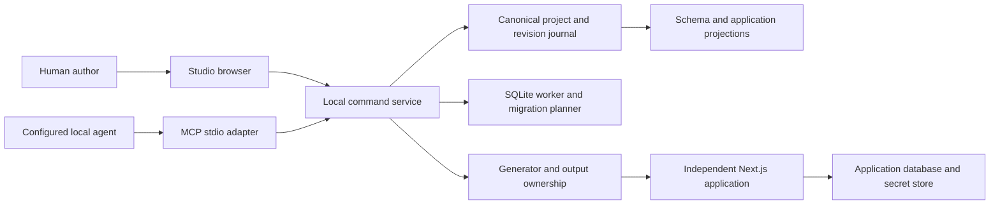

# Implementation Plan: Schema Baron Studio

**Branch**: `feat/schema-baron-studio` | **Date**: 2026-10-26 | **Spec**: [spec.md](spec.md)

## Summary and Engineering Alignment

Deliver a compact early-Studio authoring environment around one canonical typed project model. Human UI and local MCP call the same revision-checked command service. Generate ordinary Next.js applications with explicit authored extensions, independent data storage and no Studio runtime dependency.

The user confirmed intent and delegated routine decisions. Choose a local browser UI served by Node rather than a desktop wrapper for this mission. Start with Linux desktop development/testing; keep file and process adapters portable. Distribution is a documented local launcher and exportable Node application. Native packaging is not required. Full product requirements remain mandatory; this plan does not reduce them to mockups.

## Technical Context

**Language/Version**: TypeScript 7.0.x strict; supported Node.js 24 LTS line, exact supported patch pinned at bootstrap. Current host Node 26.8.1 is not proof of baseline compatibility.
**Primary Dependencies**: Next.js 16.4.x, React 19.3.x, Zod 4.6.x, better-sqlite3 13.0.x, @xyflow/react 12.12.x, decimal.js 10.6.x, official @modelcontextprotocol/sdk 1.32.x. Registry observations and security policy are in research.md. Exact compatible versions/integrities go in the lockfile at bootstrap, not floating latest installs.
**Storage**: Versioned JSON project definitions plus a transactional local metadata/journal SQLite database; separately connected application SQLite files, explicit backup/migration directories and stable secret/data locations outside replaceable output.
**Testing**: Vitest 5.x domain/contract/SQLite integration; Playwright 1.64.x authoring and generated-app journeys; production builds, strict typechecks, preservation/failure tests and screenshot/keyboard reviews.
**Target Platform**: Loopback-only Node service and modern desktop browser; Linux initial acceptance. Output is a standalone Next.js Node server, not Edge/serverless SQLite.
**Project Type**: npm-workspace TypeScript monorepo, no additional build orchestrator initially.
**Performance Goals**: NFR-001/002 budgets; worker-isolated SQLite/schema/generation jobs, bounded query previews and paged lists.
**Constraints**: Offline core after install; no external identity service; no hidden schema-specific logic; one writer service per project; all paths constrained to owner-approved project roots.
**Scale/Scope**: 50-page/200-form/1,000-control authoring fixture; 50-table/500-column schema; 100-node flow map; 10,000-row paged runtime fixture.

## Charter Check

No project or organization charter is activated. Check skipped before/after design; no invented charter requirements. Agreed constraints C-001–C-008 govern this plan. New identifiers and files only: this is not a bulk-edit mission.

## Architecture and responsibilities

The system context is an author or configured agent using Studio to produce an independent application against a chosen database. No hosted service participates in local editing.



Next.js hosts the Studio UI and its HTTP adapter; long-running SQLite/generation operations run in workers/jobs behind the service. The MCP process forwards over authenticated loopback rather than opening a second project writer. Pure model/compiler packages have no React/Next/transport dependency. The generator compiles validated model → typed intermediate representation → source files; it must not become a runtime JSON interpreter requiring Studio.

### Core operations and persistence

Use a versioned operation registry with typed input/output schemas and expectedRevision for mutations. Preview creates an immutable, expiring plan with project revision, external database fingerprint, impact and content hash. Apply accepts that plan ID/hash, explicit impact acknowledgement and a unique request ID. Atomic model changes commit with a new revision and diagnostic/change event. Repeated request IDs return the previous outcome; reusing an ID with a different payload fails.

Project JSON is readable/exportable. The service owns its save journal and lock. Write-ahead recovery coordinates metadata and atomic JSON replacement; startup completes or rolls back interrupted saves before accepting writes. Do not promise a filesystem/database distributed transaction. External model edits are imported only through validation; newer unsupported versions remain untouched. UI drafts stay separate from committed snapshots and track their base revision. Rebase only nonconflicting drafts; conflicting agent changes require explicit resolution.

### Schema lifecycle

Introspect sqlite_schema and relevant PRAGMAs, retain opaque unsupported object SQL, and use stable authoring IDs to distinguish renames from drop/create. Initial authorable types include integer, real, text, blob, boolean, date/datetime and exact decimal with explicit physical encoding. Author checks/defaults with a constrained expression grammar; imported opaque expressions remain read-only until supported. Advanced generated/virtual tables and arbitrary trigger authoring are not silently approximated.

Each mutation has reviewed SQL and impact. For rebuilds follow SQLite's documented safe procedure, preserving/recreating dependent indexes and supported triggers/views only when their semantics can be proven. Otherwise block with dependency diagnostics. Set foreign key handling deliberately before the transaction, check foreign_key_check/integrity_check before commit, and restore connection settings. Back up through the SQLite backup API, not copying a live WAL file. Hold an exclusive service migration lease and SQLite write transaction; recheck schema/data fingerprints under lock. An external writer changing data invalidates impacted previews.

The migration journal records planned/backed-up/applying/committed/failed/recovered states. Database commit may succeed before the project/journal update; a durable migration ID inside the database and startup reconciliation resolve this without running DDL twice. A restore is a separately reviewed operation, not an automatic overwrite of later data. Backups remain in owner-controlled storage.

### Query and expression model

Represent queries as typed ASTs referencing IDs, never concatenated user values or JavaScript eval. Compile and quote allowlisted identifiers separately from bound values. Distinguish WHERE/HAVING, nullable outer joins and expression result types. Support arithmetic, comparisons, conjunctions, selected date/text functions, count/sum/min/max/average and coalesce; expose a clear supported-expression list.

Prevent ambiguous aggregate fanout: preaggregate each child relation before joining, or reject the query until its grain is explicit. Derived values have read-only controls and declared source dependencies. Use exact-decimal strings/scaled integers with decimal.js at boundaries and deterministic decimal SQL helpers in the database adapter; SQL REAL is not the money arithmetic path. Document scale/rounding and overflow handling. Preview queries use a read-only connection, row cap (200), timeout/cancellation and query-cost safeguards. Inspect SQL is read-only in initial visual mode; arbitrary executable SQL is not a hidden escape hatch.

### Studio editing and visuals

CSS tokens reproduce density/proportions rather than reproducing historical bitmap chrome. Use compact menus/toolbars, docked panes, contextual tabs and focused dialogs. React Flow presents schema/application projections with stable object IDs; provide keyboard/table alternatives. Canvas position is view state, never schema meaning.

A structured page document contains supported HTML nodes plus typed form/control nodes. Design and HTML editing operate on this same supported document, preserving opaque static fragments when safe and diagnosing unsupported dynamic markup. Code view is read-only for owned files and editable for explicit extension files. Authored hooks are source modules, not strings evaluated in the model. Preview renders current draft in an isolated origin/frame with scripts restricted; it does not execute arbitrary authored server code inside Studio. Live Page targets the separately started generated app.

### Authentication and generated runtime

Generated identity uses a dedicated managed auth store or explicit mapped identity table; never assume a business table called users. Provide visible secure provisioning and migration of password hashes, with opaque server sessions, expiry, rotation at login and invalidation at logout. Use Node scrypt with versioned parameters, random per-user salt and constant-time verification; document tuning and rate limits. No default credentials in templates. Cookies are HttpOnly/SameSite and Secure on HTTPS; loopback development is explicit. State-changing requests check CSRF/origin; all runtime operations check effective access and validate input on the server. Display errors without leaking account existence or raw SQL.

Global default plus page override determines read access; action policy may tighten access but cannot bypass a protected page. Show effective rules in Studio. Links carry typed key/filter mappings; validate return context against declared internal routes. Use request-scoped reads or explicit dependency invalidation so post-write redirects see current records/totals.

Output modules: app routes/layouts/components; server validation/policy/services/repositories; SQL migrations; generated model/types; and authored extensions. Server-only modules never enter browser bundles. Include actual Next route handlers/actions, not only a generic catch-all renderer. Shared runtime utilities may be emitted as readable local code, with versions recorded; no private Studio package is needed at runtime.

### Regeneration and process lifecycle

Keep application database/secrets and migration history outside replaceable output. Use reviewed generation manifests containing source model hash, generator version, owned file hashes and extension interfaces. Reject output paths outside approved roots or symlink escapes. Stage a complete source tree on the same filesystem, preserving and hashing authored extensions. Stop the managed preview process before promotion, record a promotion journal, replace complete output with recoverable backup, and reconcile interrupted swaps at startup. Do not delete unknown files or silently repair modified owned files. Application data migration is a separate explicit operation; generation never seeds/resets it.

Do not auto-install dependencies or run project scripts merely because a model was opened. The owner explicitly starts build/run, with visible command, working directory and output. Manage child process groups, ports and cancellation. Export produces a normal Next project with relative configuration and secret placeholders; copying data is an explicit option, credentials excluded by default.

## Project Structure

Planned source directories (not yet implemented):

```text
apps/studio/                  Next UI and loopback HTTP adapter
apps/mcp/                     stdio forwarding adapter
packages/model/               schemas, IDs, policies, expressions, diagnostics
packages/core/                commands, revisions, plans and project lifecycle
packages/storage/             JSON save journal and owner-scoped paths
packages/sqlite/              workers, introspection, query compile, migrations
packages/generator/           IR, templates, ownership and promotion
packages/ui/                  compact shared editor controls and projections
fixtures/                     independent model/SQL fixtures, no production assumptions
tests/contracts/              operation and transport parity
tests/integration/            SQLite, recovery, generated output
tests/e2e/                    real authoring and application journeys
```

Use npm workspaces with explicit package exports and no cyclic dependencies. Extract packages only for the responsibilities shown, not one package per component. CSS/editor state stays near Studio; output templates do not import Studio internals.

## Implementation Concern Map

These are architectural concerns, not executable work packages. Task authoring must split broad concerns into reviewable vertical slices.

| Concern | Purpose and surfaces | Requirements | Dependencies / principal risk |
|---|---|---|---|
| IC-01 Model and operations | model/core/storage, IDs, revisions, journal, contracts, first UI/MCP project slice | FR-001, 028, 029 | None; two writers or partial saves |
| IC-02 Workspace | Studio/UI, selection, context properties, drafts, modes, visual tokens | FR-002–005, 023, 024 | IC-01; focus/draft loss |
| IC-03 Connections and schema | sqlite workers, introspection, table/relationship editor | FR-006–008 | IC-01/02; unsafe assumptions about existing DB |
| IC-04 Migration safety | plan/apply/backups/history/recovery and dependencies | FR-009, 010 | IC-03; data loss or ambiguous commit |
| IC-05 Page construction | forms/controls, bindings, wizards, list/search, record paths | FR-003, 004, 011–014, 024 | IC-02/03; wizard-only demos |
| IC-06 Runtime identity | auth setup/provisioning/policies, runtime auth, friendly login | FR-015–017 | IC-01/05; client-only enforcement |
| IC-07 Queries and reports | AST/compiler/designer, parameters, decimal and aggregates | FR-018–020 | IC-03/05; fanout, precision, unsafe SQL |
| IC-08 Flow projections | behavior map, endpoint projection, selectable diagnostics | FR-021, 022 | IC-05/06/07; duplicate graph truth |
| IC-09 Output and extensions | generator/IR/templates, independent runtime, regeneration | FR-023–027 | IC-01; begin minimal output early, extend with each feature |
| IC-10 Acceptance and operability | two authored apps, parity, keyboard/screenshots, measured NFRs, docs | FR-030, NFR-001–010 | All; evidence collected throughout, not just at end |

## Verification, delivery and risks

First demonstrable slice: blank project → table → Grid → generated public list, with project inspection/change through MCP. Add real Record/auth flows next. Add advanced schema evolution, queries/derived values and graph views as integrated behavior; do not build months of isolated editors before output works.

Every slice adds domain/adapter tests and a visible authoring scenario. Test SQLite itself, not mocked SQL strings. Use separate oracle queries/decimal calculations for reports. Security cases send direct HTTP requests, not only click hidden buttons. Recovery cases inject failures at transaction and promotion boundaries, then restart. Generated output must typecheck/build/test independently with no workspace links.

[contracts/acceptance-matrix.md](contracts/acceptance-matrix.md) maps all requirements to evidence. Record machine CPU/RAM/OS, runtime/browser versions and sample distributions for NFR budgets. Screenshot review records manual page links and deviations. No timing claims are made before measurements.

Main risks: schema rebuild dependencies, expression scope, generated/authored ownership, draft concurrency, auth/CSRF, graph performance, dependency supply chain and full-product scope. Fail closed where semantics are unknown; explicitly diagnose unsupported constructs. Do not replace missing capabilities with hidden fixture scripts.

Adversarial dependency review is explicitly deferred until the bootstrap lockfile exists; research.md records challenge topics and dispositions. No dependencies have been installed or security-audited by this planning work. Task authoring must make that review part of bootstrap readiness.

## Planning readiness

Spec committed; no unresolved product decision. Architecture, entities, operation/HTTP contracts, acceptance map, dependency research and walkthrough are recorded. Charter check remains skipped because no charter exists. This is not an implementation or a completed runtime verification. Next phase is explicit task/work-package authoring; do not start implementation from this document alone.
