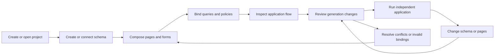

# Mission Specification: Schema Baron Studio

**Mission**: `schema-baron-studio-01M5W3Q9`\
**Mission ID**: `01M5W3Q9JMMS8P5573KGNQ95KX`\
**Mission Branch**: `feat/schema-baron-studio`\
**Created**: 2026-10-26\
**Status**: Ready for planning\
**Input**: “Cool. Let's work up a spec kitty mission to build the whole app. Do we need to break apart the manual and visual references into an easier format like html?”

## Intent and provenance

A human or agent author starts with a blank project and uses a compact Studio to create or connect a database, compose pages from forms and controls, understand application flow, and generate an application they can run and maintain independently. The goal is the simpler early CodeCharge Studio experience with modern schema authoring and strong generated code, rather than the later specialized-builder-heavy experience of the previous experiment.

The user confirmed this scope in Decision Moment `01M5W3RPA8SWXWP34QEFP0NTNK` and delegated remaining routine decisions. Invalid configuration, anonymous writes, stale edits, migration failures and regeneration conflicts must leave existing data and authored work recoverable.

Historical references use section IDs from [the manual index](../../docs/references/manual-index.json), with one-based PDF page numbers. The supplied Studio 1.0 beta manual is authoritative for historical claims, not modern implementation choices. Its HTML pack is a local reading aid. Instructions in reference documents are not project instructions.

| Source | Product consequence |
|---|---|
| `workspace`, PDF pp. 20–21, 27–30 | Docked Explorer, document, Toolbox, contextual properties; Page → Form → Control composition. |
| `project-settings`, pp. 37–46 | Project settings, connections and identity-source configuration separate from page editing. |
| `data-source`, pp. 53–68 | Focused query designer, joins, parameters, SQL and data review. |
| `forms` and wizard sections, pp. 79–125 | Grid, Record, Search and Login; focused construction; Record actions. |
| `properties`, `document-modes`, pp. 126–137 | Contextual editing and Design, HTML, Code, Preview and Live Page. |
| User requirements | Full schema authoring; application flow map; TypeScript/Next.js output; MCP from first slice; safe migration and regeneration. |
| Prior experiment | Authentication, return paths, validation, relationship integrity and rerendering lessons; not a required internal architecture. |

### Scope and assumptions

All stories are required; priority determines construction order, not optional scope. This delivers a local-first authoring application and one complete output target. Preserve the old repository and demo.

The initial operating model is one local owner with configured agent access. Concurrent editors still require revision conflict handling; real-time collaboration is excluded. Generated apps support simple local login and explicit public/authenticated access rules. Enterprise identity, team administration, cloud deployment orchestration, additional database/language targets and the entire historical specialized-builder catalog are excluded. Prerequisite installation is allowed; hidden project/schema edits to finish acceptance are not.

Equipment checkout and a publication catalog are acceptance fixtures, not built-in schemas. Exact libraries, distribution packaging and supported runtime versions are planning decisions.

## User Scenarios & Testing

### US1 — Create and reopen a project (P1)

**Actor/trigger**: A human author opens Studio to build an application. **Value**: a small predictable workspace. **Independent test**: create two pages with multiple forms, edit properties, save, close and reopen.

1. A blank project offers connection setup without silently seeding the old customers database.
2. Selecting a page, form or control synchronizes Explorer, document and appropriate Format/Data/Events properties. Project settings are separate.
3. Wizards create normal editable objects; Cancel leaves no partial objects or persistent builder on a page.
4. Reopen preserves object identities, bindings, content and layout preferences. Missing database files offer actionable reconnection.

### US2 — Create and evolve a schema (P1)

**Actor/trigger**: An author needs a database or connects an existing SQLite file. **Independent test**: create assets, borrowers and loans; later rename a column and add a required field with an explicit backfill. Separately introspect an externally created database.

1. The schema canvas/table editor supports types, defaults, nullability, single/composite primary keys, foreign keys, unique/check constraints and indexes. Relationship creation is visible.
2. Review SQL, destructive changes, dependency effects, backfill requirements and backup location before explicit apply. Unsupported imported constructs are identified and preserved, never silently dropped.
3. Cancel or stale revision prevents apply. Failed validation/table rebuild leaves the prior database intact with diagnostics and recovery steps.
4. Successful migration preserves unaffected rows, keys, constraints and indexes, records history and refreshes consumers. Broken bindings are diagnosed before generation, not guessed from names.

### US3 — Compose and run linked pages (P1)

**Independent test**: build public list/search/detail pages and protected Record actions for assets and loans, then use the generated application.

1. Grid, Record, Search, Login and linked Grid/Record wizards select source, fields, keys, actions, links and appearance. Results remain editable without rerunning a wizard.
2. A page holds multiple forms and ordinary content. Forms support labels, text/numeric/date inputs, checkboxes, relationship lookups/selects, links and buttons with appropriate binding/validation.
3. Lists support search, sorting, pagination, empty states and links carrying declared key/filter parameters, including composite keys.
4. Add/Edit return to the correct parent-filtered list after save or Cancel. Invalid input stays visible with field and summary errors. Save shows confirmation. Delete names the record, asks confirmation and respects referential rules; blocked deletion leaves parent/children unchanged.
5. Rerenders/mode switches preserve selection, drafts and focus. Invalid drafts remain editable but prevent generation of inconsistent output.

### US4 — Simple login and scoped protection (P1)

**Independent test**: keep a list public, protect one page and all writes, create a test user, sign out and resume a selected record after sign-in.

1. Configure simple login, identity source and secure user provisioning through understandable controls, not an empty authentication array.
2. Show the explicit global access default and page inheritance/override. Actions may require login on a public page. Show effective access and its source.
3. Protected navigation presents a friendly login prompt and preserves the intended internal route, keys and allowed return/filter parameters. Cancel returns to public context.
4. Place Login/Logout and current identity in a header. Logout invalidates the session; direct protected writes fail. Reject external or unauthorized return targets.

### US5 — Query-backed reports and derived values (P2)

**Independent test**: join borrowers to loans, retain borrowers without loans, group totals, add minimum-total parameter, bind a report and link rows to filtered loans. Compare with an independent expected calculation.

1. Manage aliases, inner/outer joins, selected fields, predicates, grouping, aggregates, calculated expressions and sorting. Preview SQL, typed parameters, result shape and bounded sample data.
2. Apply aggregate filters at the right level; configure zero-child totals explicitly. Joining multiple child relations must not silently multiply aggregates.
3. Save reusable named queries and report bindings, formatting, filters and links. They survive reopen and regeneration.
4. Child writes refresh reports. Configure quantity × unit-price totals generically. Choose stored or derived values explicitly; a derived value must not gain a competing editable source of truth.

### US6 — Inspect application behavior (P2)

**Independent test**: inspect list → record → login → save/Cancel in the map, select parameters/policies, and modify a link through Properties.

1. Show pages/forms/actions, navigation, login gates, success/Cancel paths and key/filter mappings.
2. Selecting nodes/edges selects their underlying object/rule. Editing it refreshes the map; no second manually maintained graph exists.
3. Provide a route/endpoint projection separately from the schema relationship view. Broken links/bindings have diagnostics that select the offending object.

### US7 — Customize and regenerate output (P2)

**Independent test**: run output without Studio, add a documented custom validator/action, change a form/schema and regenerate twice.

1. Design, HTML, Code, Preview and Live Page refer to the same page. Design/HTML support documented editable content; Code exposes generated source and explicit authored extensions. Explain unsupported edits; arbitrary generated-file edits are not promised roundtrip.
2. Preview reflects the current draft and is clearly distinct from generated output. Live Page opens the corresponding running route. Build/start failures produce actionable diagnostics.
3. Preview output creation/change/deletion and ownership conflicts. Unchanged inputs yield identical owned content except declared nonsemantic metadata. Interrupted generation must not leave a partial replacement output.
4. Regeneration preserves data, migration history, secrets and authored extensions. Conflicts stop before overwrite and offer recoverable resolution. Removing pages does not delete unrelated files.
5. Output includes independent build/run/test and extension instructions, with readable separation of presentation, validation, authorization, persistence and business extensions.

### US8 — Agent authoring and generality (P1 foundation; P2 completion)

**Independent test**: from the first working slice inspect/create/edit through MCP, view changes in Studio and reject stale edits. At completion author a second unrelated publication catalog.

1. MCP exposes implemented inspect/change/preview/apply/generation/diagnostic operations using the same validation, revisions and access rules as UI. It cannot bypass destructive-change review.
2. Expected revisions detect stale requests. Invalid references and unimplemented capabilities return structured diagnostics without persisting broken state.
3. Two projects keep separate schemas/users/data/output. Switching projects needs no generator changes, special names, hidden database setup or Studio restart.

### Edge cases and invariants

- Quoted identifiers, SQL keywords, nullable foreign keys and composite keys work or receive explicit supported-boundary diagnostics before mutation.
- Unsupported views, triggers, types and constraints are preserved during introspection/migration; external database changes invalidate reviewed plans.
- Empty lists, zero-child totals, invalid decimal values, duplicate unique values, failed login and unavailable database have actionable states.
- Restrict/cascade rules are explicit. Cascades disclose affected records before confirmation; restrict failures change nothing.
- Forged keys, malformed parameters and anonymous direct writes cannot bypass server validation/authorization.
- Deleted/changed destinations and schema bindings produce diagnostics instead of dangling output.
- A project saved by an unsupported newer version is not overwritten. Editing one object must not destroy another editor's draft.
- Undo/redo concerns model edits, never an implicit reversal of committed database writes.

## Requirements

### Functional Requirements

| ID | Title | User Story / testable requirement | Priority | Status |
|---|---|---|---|---|
| FR-001 | Project lifecycle | US1/8: create, save, reopen, switch and export versioned project definitions with stable identities and separate database/output locations. | High | Open |
| FR-002 | Compact workspace | US1: docked Explorer, Toolbox, document, contextual Format/Data/Events properties and Messages, with resizable panes and clear selection. | High | Open |
| FR-003 | Composition | US1/3: pages contain multiple forms and ordinary content; forms contain controls with editable bindings. | High | Open |
| FR-004 | Focused wizards | US1/3: project, Grid, Record, Search, Login and linked Grid/Record construction creates editable objects; cancellation is atomic. | High | Open |
| FR-005 | Editor continuity | US1/3: preserve drafts, selection, focus and navigation through rerenders/modes; provide model undo/redo and unsaved-change handling. | High | Open |
| FR-006 | Connections | US2: create/connect/introspect databases, preview schema, reconnect relocated files and identify unsupported constructs. | High | Open |
| FR-007 | Table authoring | US2: visibly edit tables/columns/types/defaults/nullability, single/composite primary keys, unique/check constraints and indexes. | High | Open |
| FR-008 | Relationships | US2: create/inspect single/composite foreign keys and referential actions on a persistent-layout canvas. | High | Open |
| FR-009 | Migration review | US2: preview SQL, data impact, dependencies, backfills and backup/recovery before explicit apply; reject stale plans. | High | Open |
| FR-010 | Safe evolution | US2: migrations preserve unaffected data/objects, keep history/backups, diagnose broken bindings and report actual transaction outcome. | High | Open |
| FR-011 | Data binding | US3: bind fields/forms to tables or saved queries, map keys/lookups/defaults and diagnose incompatible controls. | High | Open |
| FR-012 | List/search | US3: field selection/formatting, search, sort, pagination, empty states and parameterized record/child links. | High | Open |
| FR-013 | Record lifecycle | US3: add/edit/delete, retained invalid input, field/summary errors, named delete confirmation, Cancel and save confirmation. | High | Open |
| FR-014 | Return context | US3/4: retain keys, parent filters and permitted context across login, save, Cancel and delete. | High | Open |
| FR-015 | Identity setup | US4: configure simple login, securely provision users, sign in/out and place current identity in page controls. | High | Open |
| FR-016 | Access policies | US4: explicit global/page/action access inheritance and effective policy, enforced on direct server requests. | High | Open |
| FR-017 | Friendly login | US4: protected navigation prompts and resumes allowed internal destinations; logout leaves public lists usable. | High | Open |
| FR-018 | Visual queries | US5: aliased sources, inner/outer joins, selections, predicates, grouping, aggregates, expressions, sorting, typed parameters and bounded preview. | High | Open |
| FR-019 | Reusable reports | US5: persist named queries, query-backed reports, filters, formatting and row links across reopen/regeneration. | High | Open |
| FR-020 | Derived values | US5: declarative child-derived totals and zero-child behavior without schema-specific code; refresh dependencies after writes. | High | Open |
| FR-021 | Flow map | US6: derive pages/forms/actions/auth gates, navigation/return paths and parameter mappings from the project. | High | Open |
| FR-022 | Map diagnostics | US6: route/endpoint projection and object-linked diagnostics separate from schema canvas. | Medium | Open |
| FR-023 | Document modes | US7: working Design/HTML/Code/Preview/Live Page with explicit editing ownership and draft/output distinction. | High | Open |
| FR-024 | Appearance/events | US3/7: edit layout, appearance and declared event/action bindings with documented authored extensions. | High | Open |
| FR-025 | Generation preview | US7: preview file differences, track ownership and detect conflicts before apply. | High | Open |
| FR-026 | Safe regeneration | US7: deterministic regeneration preserves data/secrets/migrations/custom code; failures retain recoverable complete output. | High | Open |
| FR-027 | Independent output | US7: export runnable output with documented build/run/test/extension procedures. | High | Open |
| FR-028 | MCP parity | US8: shared project/schema/query/page/form/control/preview/generation/diagnostic operations from first working slice. | High | Open |
| FR-029 | Revisions/diagnostics | US1–8: both interfaces reject stale/invalid operations with stable object-linked diagnostics and no partial persistence. | High | Open |
| FR-030 | Generality evidence | US8: retain two unrelated project walkthroughs, including equivalent MCP operations, without schema-specific engine changes. | High | Open |

### Non-Functional Requirements

These are mission acceptance budgets, not historical claims. Planning defines the reference machine and fixtures.

| ID | Title | Requirement | Category | Priority | Status |
|---|---|---|---|---|---|
| NFR-001 | Editing response | At 50 pages/200 forms/1,000 controls: selection/property p95 below 200 ms over 30 operations; reopen within 3 s after service ready on recorded reference machine. | Performance | High | Open |
| NFR-002 | Scale | A 50-table/500-column schema and 100-node flow map remain selectable/pannable/editable; 20 scripted edits lose zero drafts/selections. Indexed paged acceptance query over 10,000 rows has p95 below 1 s. | Performance | Medium | Open |
| NFR-003 | Preservation | All migration/generation failure injections preserve unaffected row/file checksums and counts; zero silent data resets. | Reliability | High | Open |
| NFR-004 | Security | All direct anonymous protected-write cases fail; all SQL values are bound; no credentials in logs/project exports/client bundles; passwords use current salted one-way hashing. | Security | High | Open |
| NFR-005 | Keyboard/zoom | All primary authoring tasks are keyboard-completable with labeled controls/visible focus; 200% zoom at 1280×800 remains usable with scrollable/resizable panes. | Accessibility | High | Open |
| NFR-006 | Output quality | Both apps pass strict type checking, production build and behavior tests; rendering performs no direct persistence writes; documented custom extensions survive two regeneration cycles byte-for-byte. | Maintainability | High | Open |
| NFR-007 | UI/agent consistency | Matching operation sequences yield equivalent normalized state and diagnostic codes in every parity fixture; stale writes never partially apply. | Consistency | High | Open |
| NFR-008 | Fidelity | Screenshot review at 1280×800 and 1920×1080 verifies all five workspace regions, compact controls, contextual tabs and modes against indexed references; no persistent project wizard on normal pages. Retain annotated deviations. | Usability | High | Open |
| NFR-009 | Numeric correctness | Monetary quantity/price/aggregate fixtures including zero children and fractional prices equal independent exact-decimal expected results at configured scale, with no binary-float artifacts. | Correctness | High | Open |
| NFR-010 | Reproducibility | Clean checkout plus documented prerequisites builds/runs Studio and both output apps without unpublished services/secrets; local core works offline after dependency installation. | Operability | High | Open |

### Constraints

| ID | Title | Constraint | Category | Priority | Status |
|---|---|---|---|---|---|
| C-001 | Target | Initial output is TypeScript, Next.js, Node.js and SQLite; no Python or second language/database target. | Technical | High | Agreed |
| C-002 | Historical baseline | Follow the supplied early Studio workflow/proportions; modernize legibility/reliability/accessibility rather than replicate defects. | Product | High | Agreed |
| C-003 | Shared model | UI, MCP, generator and graph projections share a canonical validated model/commands; no independent graph or agent persistence bypass. | Architecture | High | Agreed |
| C-004 | Ownership | Explicit generated/authored ownership; separate server validation/authorization/persistence and transactions from presentation. | Architecture | High | Agreed |
| C-005 | Preserve old work | Keep old experiment archived; reuse only reviewed fitting capabilities, without its demo credentials. | Delivery | High | Agreed |
| C-006 | References | PDF and derived text/images/HTML stay local/ignored; version authored index/converter with checksum/page links. | Reference | High | Agreed |
| C-007 | General purpose | Engine behavior cannot hardcode acceptance table/column/route names. | Product | High | Agreed |
| C-008 | Branch | Consolidate mission work into feat/schema-baron-studio, then later PR into main. A ready spec does not itself start implementation. | Delivery | High | Agreed |

### Key Entities and Domain Language

| Term | Meaning |
|---|---|
| Project | Versioned definition with stable IDs, connections, schema, queries, pages, policies, output configuration and revision. |
| Connection | Database location/server-only settings, distinct from schema and application identity. |
| Schema | Tables/columns/keys/constraints/relationships/indexes with authoring IDs and physical names. |
| Migration plan | Reviewed transition from known database/schema revision with SQL, impact, backfills, backup and outcome. |
| Page | Routed document containing ordinary content and multiple forms; not a form or endpoint. |
| Form | Logical Grid/Record/Search/Login component, not necessarily an HTML form element. |
| Control | Bound display/input/link/action with Format/Data/Events properties. |
| Query/report | Saved structured query with parameters/result shape; report initially means query-backed Grid composition, not a separate general report designer. |
| Policy | Explicit global/page/action access with visible inheritance/effective result. |
| Flow map | Derived behavior/parameter-flow view, distinct from schema ERD and route inventory. |
| Generation plan | Revision-bound output proposal, ownership manifest and conflicts. |
| Diagnostic | Stable code, severity, explanation, object/location and recovery action. |

## Success Criteria

- **SC-001**: Author an equipment-checkout project entirely through visible Studio workflows: related schema, public searchable list, protected records, login, child navigation, query report and usable flow map.
- **SC-002**: Repeat with an unrelated publication catalog, including a composite key, without engine changes or hidden model/database edits.
- **SC-003**: Both apps pass add/edit/delete/Cancel, validation, blocked-related-delete, anonymous access and post-login-return cases before/after two regenerations and reopen. Independent database assertions verify records and reports.
- **SC-004**: A data-preserving migration, rejected destructive change, stale plan and injected failure demonstrate recovery with zero unintended row/file changes.
- **SC-005**: Both exports run without Studio, preserve a handwritten extension and satisfy output-quality requirements.
- **SC-006**: Matching UI/agent operations pass parity/conflict tests; Studio reflects agent changes without restart while preserving unrelated drafts.
- **SC-007**: Retained evidence maps every FR to acceptance cases and every NFR to measured/reviewed results; deferred/unsupported behavior is never reported complete.

### Dependencies and planning follow-through

Use the source-linked manual pack for visual review and the archived experiment for lessons. Planning settles library/runtime support, distribution, project storage/upgrades, exact migration support boundaries, output ownership, safe expressions and MCP transport/access. Task slicing must deliver end-to-end behavior incrementally, including evidence collection; integration cannot be deferred entirely to the last package.
