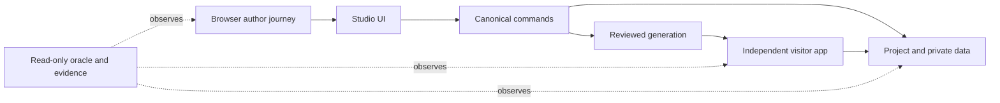

# Implementation Plan: Studio Verification and Hardening

**Branch**: `feat/studio-verification-hardening` | **Date**: 2026-10-31 | **Spec**: [spec.md](spec.md)\
**Input**: User-confirmed verification scope and delegated planning choices.\
**Status**: Planning complete; implementation and acceptance have not started.

## Summary

Build reproducible acceptance around the existing Studio and generator rather than adding another application builder. Start from the milestone checkpoint, inventory real evidence, author Workshop Planner and Library Catalog through browser controls, expose and repair gaps through their shared production paths, then validate isolation, security, recovery and independent regenerated output. Keep the normal authoring path visible and compare persisted results with independent expected data. Plan six implementation concerns, not an unbounded stream of demonstrations.

## Technical Context

**Language/Version**: Existing TypeScript 7.0.2 on Node 24.22.1 / npm 11.19.1; small existing Node test/runner scripts remain JavaScript modules.\
**Primary Dependencies**: Existing Next 16.4.3, React 19.3.1, better-sqlite3 13.0.3, Vitest 5.0.5, Playwright 1.64.1 and current lockfiles. No dependency additions/upgrades selected.\
**Storage**: Private SQLite business/identity stores and canonical project metadata; replaceable generated source remains separate. Acceptance evidence is sanitized JSON/Markdown/screenshots with private raw results outside Git.\
**Testing**: Vitest behavior/integration tests, Playwright author/visitor journeys, independent read-only SQLite oracles, fault-controlled isolated recovery tests, two fresh complete browser cycles and a separate reviewer walkthrough.\
**Target Platform**: Supported Linux x64/glibc with loopback services, pinned tools and denied lifecycle scripts.\
**Project Type**: Existing npm workspace; Studio + core/model/storage/SQLite/generator packages, generated independent Next app.\
**Performance Goals**: NFR-004/005: bounded fixture, 30 UI samples, p95 feedback ≤2 seconds, valid Save ≤5 seconds, zero unintended draft/caret changes. Record hardware/load and raw samples; do not silently relax thresholds.\
**Constraints**: No hidden model/data/source repairs; no upgrades, merge or deployment; preserve user studies and historical captures; use documented runtime commands and explicit owned process shutdown only.\
**Scale/Scope**: Two unrelated applications, 20 mandatory cases, 17 FR, 6 NFR, 6 C; each app regenerated twice in each of two clean cycles. Current lookup support is one table value field and at most 200 options.\
**Engineering Alignment**: Use the existing architecture and test tools. Author through Studio, observe independently, fix shared product behavior where needed, replay exact scenarios. User delegated these choices; no unresolved planning questions.

## Charter Check

No project/org charter is configured; charter-specific synthesis/checks are skipped, not passed. The action-scoped context reported the missing charter. Apply explicit repository policy: scripts denied, no private evidence, no touching prior studies, current target only, shared command semantics, truthful gate results. The same check remains satisfied after this plan because it introduces no dependency/platform/security exception. Hosted Spec Kitty journal/sync reported storage/auth/route warnings; local artifacts and local decision verification are authoritative for this planning result. Do not claim hosted publication succeeded.

## Project Structure

### Documentation (this mission)

- `spec.md`: actors, scope, invariants, requirements and finish line.
- `checklists/acceptance.md`: AC-001..020, all Not run until executed.
- `checklists/requirements.md`: spec quality only.
- `plan.md`, `research.md`, `data-model.md`, `quickstart.md`.
- `contracts/evidence.schema.json`: planned observation contract.
- `contracts/acceptance-run.md`: run, defect and verdict protocol.
- `decisions/`: canonical delegated-scope record.
- `tasks.md` and executable WP prompts are intentionally not authored in the plan phase.

### Source Code (repository root)

- `apps/studio/src/project-wizard/`, `schema-editor/`, `forms/`, `security-editor/`, `query-designer/`, `source-editor/`, `flow-map/`, `runtime-ui/`, `workspace/`: exercise existing authoring surfaces; change only reproduced gaps.
- `apps/studio/src/server/`: workspace/setup/service/runtime boundaries and private service lifecycle.
- `packages/model/`, `core/`, `storage/`, `sqlite/`, `generator/`: shared validation, transactional commands, migration, lookup/navigation/report/record/regeneration and output boundaries.
- `tests/e2e/project-wizard/`, `forms/`, `schema-editor/`, `security-workflow/`, `query-designer/`, `reports/`, `document-modes/`, `regeneration/`, `runtime-export/`: reuse proven helpers/assertions; do not duplicate their historical evidence.
- Planned `tests/e2e/acceptance/`: separate Workshop and Library journeys plus helpers driven by actual UI controls.
- Planned `fixtures/acceptance/`: synthetic scenario descriptors and independent expected values; never pre-authored Studio model JSON for cold-start journeys.
- `tests/integration/recovery-matrix/`, `packages/core/tests/runtime/`, `packages/generator/tests/record/`: bounded fault and independent generated-runtime tests.
- Planned `scripts/acceptance/`: runner, evidence validation and final requirement report using current tooling; reuse `scripts/release/toolchain.mjs` for tool resolution.
- Planned `docs/evidence/verification/` and user-guide updates: concise sanitized final evidence index and reproducer, not raw credential-bearing traces.

**Structure Decision**: Extend the current test/workspace architecture. No parallel mock builder or new service layer. Fixture descriptions state inputs/expected outputs; the authoring journey must still create ordinary real project entities.

## Verification Architecture and Boundaries

The observer can inspect a committed model or read business rows, but cannot write a successful scenario into existence. Canonical-command/MCP parity and failure injection are separate labeled cases. Use fresh ports, explicit temporary owner config and browser contexts; do not change the user's live application's files, credentials, data or ports. Observe processes by recorded PID/birth identity and stop only owned children.

## Execution Strategy

1. **Inventory before new claims**: pin baseline SHA, catalogue the 20 cases against current suites, classify historical evidence and record exact missing proof. Source inspection already found a candidate Code-mode issue: `apps/studio/src/source-editor/index.tsx` initializes `output:app`, unlike Generate's per-project default. Reproduce it through a fresh UI project before assigning severity or declaring it fixed.
2. **Fresh Workshop journey**: construct the two-table schema and known records through the wizard; use ordinary Properties to configure names, row links and protected actions. Audit every external setup action. If authoring a required setting needs a project.batch repair, record a failing case and repair the UI/shared operation first.
3. **Fresh Library journey**: use the data model/oracle below, including the composite book-author key, unique values, optional dates, exact amounts and zero-child rows. Reuse generic helpers without teaching the generator table names. Connect the existing-database variant using a read-only checkpoint made from the cold-start Library database and compare bytes/rows around inspect/Cancel.
4. **Targeted hardening**: prioritize any incorrect persistence/authorization/context, source conflict, false-success or draft/render loss. Add a regression at the lowest useful seam plus the browser scenario that exposed it. No blanket rewrites, sleeps/retries to hide races, disabling validation or altering expected data to fit current output.
5. **Regeneration and independent use**: declare/edit one supported authored extension in Code mode, inspect output, generate twice, compare hashes/rows and rebuild explicitly. Exported identity is deliberately excluded; independent visitor use points at a documented external isolated business database with its adjacent private identity store, or deliberately provisions a new private identity. Never imply export contains secrets.
6. **Closeout**: run two consecutive fresh complete cycles at the final revision; preserve failures and retests, evaluate all requirements/NFRs/constraints, record hosted checks separately and obtain review by a different author/reviewer identity. Only then offer a milestone verdict. No automatic merge/deploy.

## Implementation Concern Map

These are planning concerns, not work packages or claims of task completion.

### IC-01 — Acceptance inventory and evidence discipline

- **Purpose**: Make missing proof visible and establish run/defect/verdict contracts.
- **Relevant requirements**: FR-001, FR-016, FR-017; NFR-003, NFR-006; C-002,C-005,C-006.
- **Affected surfaces**: planned `scripts/acceptance/`, `fixtures/acceptance/`, mission checklist/contracts and `docs/evidence/verification/`.
- **Sequencing/depends-on**: none; other concerns use its evidence format.
- **Risks**: counting historical tests as fresh proof, false-positive green runs, erased failed attempts, credentials in traces, very large committed evidence.

### IC-02 — Workshop cold-start and related workflow

- **Purpose**: Reproduce the milestone's useful path wholly through Studio, including schema, flow, login, names/links/context and reopening.
- **Relevant requirements**: FR-002, FR-004..008; NFR-001, NFR-004; C-003.
- **Affected surfaces**: planned `tests/e2e/acceptance/workshop.spec.ts`, shared UI helpers, Studio setup/forms/property surfaces and generator paths only if a reproduced gap requires it.
- **Sequencing/depends-on**: IC-01.
- **Risks**: inheriting retained app configuration, seeding model JSON, direct-command shortcuts, invalid test success from cached visitor pages.

### IC-03 — Library generality and query correctness

- **Purpose**: Exercise different cardinality, composite identity, NULL/uniqueness, exact totals and independent query oracles.
- **Relevant requirements**: FR-003, FR-004, FR-006, FR-007, FR-009; NFR-001; C-001,C-004.
- **Affected surfaces**: planned `tests/e2e/acceptance/library.spec.ts`, fixture descriptors/oracles, schema/query/report forms and generator/compiler as failures demand.
- **Sequencing/depends-on**: IC-01; reuse stabilized generic helpers from IC-02.
- **Risks**: double-counting joins, comparing rounded values, silently dropping zero-child rows, using a single-key shortcut for the association Record.

### IC-04 — Access, draft/render and failure recovery

- **Purpose**: Verify boundary enforcement and recovery without lost author or business state.
- **Relevant requirements**: FR-008, FR-013..015; NFR-001,NFR-002,NFR-005.
- **Affected surfaces**: `tests/e2e/document-modes/`, `tests/e2e/security-workflow/`, `tests/integration/recovery-matrix/`, shared core/service/runtime and editor recovery paths.
- **Sequencing/depends-on**: IC-01 and fresh fixtures from IC-02/03.
- **Risks**: sensitive traces, race masking, destructive failure injection into user studies, calling unsupported architectural tooling a pass.

### IC-05 — Authored code, regeneration and independence

- **Purpose**: Show two genuine regenerations per fixture preserve all intended state and declared authored bytes; independently run/export each app.
- **Relevant requirements**: FR-010..012, FR-014; NFR-001,NFR-002; C-005.
- **Affected surfaces**: source editor, generation/runtime/export UI, generator ownership/recovery, `tests/e2e/regeneration/`, `runtime-export/`, planned acceptance runners.
- **Sequencing/depends-on**: IC-02/03; recovery checks coordinate with IC-04.
- **Risks**: Code-mode destination mismatch, regenerating a live runtime, installing/building before predecessor finishes, confusing derived source with private DB/identity state.

### IC-06 — Clean replay, usability and verdict

- **Purpose**: Provide a finite final release judgment supported by reproducible fresh runs and a different reviewer.
- **Relevant requirements**: FR-001, FR-016, FR-017; NFR-003..006; all constraints.
- **Affected surfaces**: runner/report scripts, `.github/workflows/checks.yml` only if integrating established commands, final evidence index and supported user procedure.
- **Sequencing/depends-on**: IC-01..05.
- **Risks**: moving the finish line, deferring a failed mandatory case as cosmetic, green checks on an earlier revision, missing hosted checks presented as passed.

## Validation and Change Control

- Red/green: reproduce the defect, record failing assertion/outcome, make a minimal shared fix, rerun the focused case, then run appropriate broad checks. Validate real persisted rows or rendered outputs; avoid tests that mirror implementation.
- Scope: an unknown issue joins this mission only when it blocks or validates an existing AC/FR/NFR. Otherwise record it separately. Changes to a requirement return to specification rather than silently appearing in the plan.
- Meaningful adversarial checks: unauthorized direct writes/returns/paths, repeated request IDs, stale revisions and controlled interrupt/recovery outcomes. No new mutation-testing dependency is planned; if changed assertion quality is uncertain, use a reversible bounded fault to show the assertion notices the wrong behavior, retaining its red/green outcome.
- Final checks: current source's full Vitest suite, type/build/lint/credential/dependency/native checks, both clean browser journeys twice, focused fault/independence cases and manual/reviewer observation. Existing NOT IMPLEMENTED or unavailable tooling must remain clearly identified rather than fabricated passes.
- Evidence: final checks run after the last implementation change. A documentation-only verdict edit records the validated code SHA and documentation SHA separately, avoiding an endless test-for-prose loop.

## Rollout, Review and Complexity

This plan does not deploy or merge. Keep the user studies online/unchanged where possible; isolated acceptance owns its services and output. A follow-up PR is based on the milestone ancestry; rebase/target updates require normal explicit Git workflow after PR #1 lands. No platform/dependency decision or project-charter exception is introduced. Known limitations stay visible and are not removed by broad scope creep. Independent review and a fully populated acceptance ledger are mandatory to declare this mission achieved.
