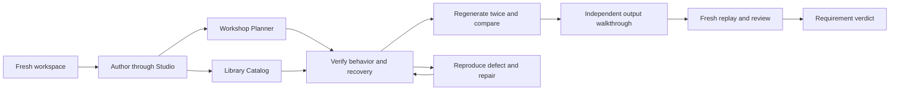

# Mission Specification: Studio Verification and Hardening

**Mission Branch**: `feat/studio-verification-hardening`\
**Created**: 2026-10-31 (America/Chicago; canonical creation timestamp is in meta.json)\
**Status**: Specified; execution not started\
**Input**: “Yes, let's create a Spec Kitty mission for verification and hardening. Use Workshop Planner and a second unrelated app, define the acceptance checklist and finish line, and proceed with your best judgment.”

## Confirmed Intent and Scope

The primary actor is a local Studio author starting a fresh project. The author must be able to design or connect its data, understand the proposed pages and application flow, configure public browsing and protected writes, run the application, and safely regenerate it without an agent repairing hidden configuration. A visitor must be able to browse, sign in, edit valid records, and return to the selected context. A reviewer must be able to reproduce the evidence and distinguish observed behavior from plans and historical claims.

The user confirmed this scope and delegated remaining choices. The second fixture is **Library Catalog**, selected for different names, a many-to-many association with a composite key, unique identifiers, optional dates, exact monetary values, and deeper relationships. This is a verification and targeted repair mission, not a rewrite or another feature-expansion mission. Specifying a test does not mean it has passed.

Baseline: milestone PR #1, https://github.com/LynnColeArt/schema-baron/pull/1, source commit `fe22d9b06be0967b1dec89c352d2979787330f34`. Its 496 passing tests and manual Workshop Planner demonstrations are historical inputs; this mission must produce fresh evidence. Planning/integration occurs on `feat/studio-verification-hardening`; a later PR may stack on the milestone branch until PR #1 lands. No merge, deployment, runtime upgrade, or new hosted account is implied.

## User Scenarios & Testing *(mandatory)*

### User Story 1 - Build Workshop Planner without hidden assistance (Priority: P1)

An author creates a fresh Workshop Planner through the wizard and reusable schema editor, with workshops and related sessions. They review the default pages, login/access choices and flow chart before completion. They generate into the project's own folder, run it, create the workshop and sessions, and follow named workshop links to a filtered sessions list. Add preselects the workshop; Save and Cancel retain that context.

**Why this priority**: This is the current happy path and the minimum usable baseline.

**Independent Test**: Use a new private workspace and an untouched copy of the authored dataset, with no prewritten Studio project definition or hidden model edits.

**Acceptance Scenarios**:

1. **Given** an empty workspace and a non-existent chosen parent folder, **when** the author completes the wizard, **then** its folder, new database, keys and editable page definitions exist at the reviewed locations without manual directory creation.
2. **Given** the three known session examples, **when** the author follows a workshop name and adds a session, **then** the list is scoped correctly, names replace foreign-key IDs in displayed rows, the parent is preselected, and Save/Cancel return to the same list.
3. **Given** a signed-out visitor, **when** they browse then request Add/Edit/Delete, **then** browsing stays public, writes are protected at page and direct-handler boundaries, and login retains the typed selected context.
4. **Given** a valid saved project, **when** it is reopened or regenerated twice, **then** data, relationship displays, access choices, queries, reports and navigation remain correct.

### User Story 2 - Build an unrelated Library Catalog (Priority: P1)

An author builds a Library Catalog with authors, books, book-author associations, copies and loans. Each book can have multiple authors; book-author identity is the ordered pair. Books have a unique catalog identifier and optional publication date; copies have a unique barcode and exact replacement cost; loans have optional return dates. Both a book without authors/copies and a copy without loans are represented. All people and loans are synthetic examples.

**Why this priority**: A second schema must expose assumptions that a single parent-child demonstration cannot.

**Independent Test**: A fresh Library project is authored through Studio. A supplied existing-database variant is also connected through the wizard; its schema/data are checked unchanged after inspection and Cancel.

**Acceptance Scenarios**:

1. **Given** the Library schema, **when** the author creates association records, **then** all ordered composite key fields participate in navigation and record identity; duplicate keys/barcodes/catalog identifiers produce clear errors and no partial writes.
2. **Given** known rows including zero-child cases and multiple authors, **when** the author builds an author/book-count report and a separate book/copy-value report, **then** counts and exact totals match an independent oracle without multiplication from joins; a threshold filter includes/excludes the expected rows.
3. **Given** a book or copy with dependents, **when** deletion is attempted under a restrict relationship, **then** the error identifies related records and leaves all affected rows unchanged.
4. **Given** saved values and reports, **when** schema changes and regeneration are reviewed and applied, **then** their declared effects alone occur and the unrelated Workshop project is unchanged.

### User Story 3 - Recover from ordinary failures without losing work (Priority: P1)

An author enters incomplete input, switches documents/projects, reloads, encounters a rejected change or failed runtime start, and resumes with understandable status. Valid and invalid drafts remain associated with the correct project and object. Rendering or remote revision notifications must not silently replace current edits.

**Why this priority**: The previous iterations revealed draft, render and regeneration fragility that happy-path examples miss.

**Independent Test**: Exercise recovery with isolated projects and controlled failure fixtures; compare model/data/draft snapshots before and after each rejected action.

**Acceptance Scenarios**:

1. **Given** an unsaved schema/query/control draft, **when** an unrelated revision notification, view change, project switch or supported recovery reload occurs, **then** text, selection, ownership and save status remain consistent; conflicts are explicit.
2. **Given** duplicate submission, stale revision, changed database identity, occupied runtime port or invalid destination context, **when** an action is rejected, **then** it presents an actionable error without committing partial model/data changes or silently weakening authentication.
3. **Given** an interrupted reviewed migration or regeneration, **when** recovery is followed, **then** a verified committed state or explicit recoverable state is shown; no false success, business-data replacement or authored-code overwrite occurs.

### User Story 4 - Reproduce and judge the milestone (Priority: P1)

A reviewer follows the published procedure from a clean checkout and obtains the two applications and a requirement-by-requirement report. The reviewer can stop Studio and use the generated/exported app independently, with declared deployment configuration and its private identity store.

**Why this priority**: A finite milestone needs checkable proof and a truthful verdict.

**Independent Test**: Two consecutive clean acceptance runs, followed by a reviewer walkthrough using only the documented instructions.

**Acceptance Scenarios**:

1. **Given** acquired supported tooling, **when** the reviewer performs each documented journey, **then** setup/runtime commands are explicit and no undocumented model edits, database patches, source fixes or direct-command shortcuts substitute for authoring through Studio.
2. **Given** saved data and a declared authored extension, **when** an application is regenerated twice and exported, **then** data and declared authored bytes survive, source changes are reviewed, and the independent app works with Studio unavailable.
3. **Given** an acceptance failure, **when** it is triaged and repaired, **then** the same scenario is rerun on the repaired revision and the final ledger links the defect, fix and fresh result; old evidence is not overwritten.

### Edge Cases

- Missing folders, spaces in paths, duplicate project names, Cancel before Complete, changed/missing external databases, and metadata/output/database path separation.
- Empty tables, zero-child rows, NULL dates/costs where declared nullable, duplicate display names with different keys, quoted identifiers, and all fields of an ordered composite key.
- Empty equality filters mean no predicate/default; contains/range filters never become new-record values; conflicting parent contexts fail clearly; existing record values are never overwritten by Add defaults.
- Related rows prevent restrict deletion; validation, uniqueness and foreign-key failures leave parent/child rows unchanged.
- Lookups at the supported 200-option boundary and an exceeded boundary: truthful bounded behavior or a useful diagnostic, never truncation presented as a complete choice set.
- Unauthorized direct writes, malformed/external return targets, stale/expired sessions, duplicate requests, session refresh across tabs, and project/draft isolation.
- Generator conflicts, modified owned files, preserved declared authored modules, rebuildable artifacts, occupied ports and interrupted operations; do not delete user studies to simulate failure.

## Requirements *(mandatory)*

### Functional Requirements

| ID | Title | User Story | Priority | Status |
|----|-------|------------|----------|--------|
| FR-001 | Acceptance ledger | A reviewer can trace every requirement and checklist case to a run, source revision, fixture, expected result, observed result and retained evidence; pending/skipped/failed never count as passed. | High | Open |
| FR-002 | Fresh Workshop project | An author can create, configure, generate, run and reopen Workshop Planner through Studio from an empty workspace and a missing chosen folder. | High | Open |
| FR-003 | Unrelated Library project | An author can create Library Catalog through Studio and connect an existing-database variant without inspection/Cancel changing that database. | High | Open |
| FR-004 | Reusable schema lifecycle | An author can create tables, scalar types, primary/foreign/unique keys in the reusable editor, revisit it later, review a safe schema change and observe only its declared effects. | High | Open |
| FR-005 | Editable page workflow and map | The proposed pages, access and flow preview correspond to the completed editable Page → Form → Control objects; edits and flow/settings shortcuts reopen the correct project. | High | Open |
| FR-006 | Related browsing and Add context | Names resolve to stable keys, parent links filter the correct children, and Add/login/Save/Cancel preserve typed parent context while preselecting only new-record fields. | High | Open |
| FR-007 | Validated transactional records | Create/edit/delete support clear validation, uniqueness and related-record errors, confirmations naming the record, Cancel without writes and no partial rows after failed actions. | High | Open |
| FR-008 | Public/private access | Public browsing remains public; protected pages and direct write handlers reject anonymous use; login/logout and validated return targets behave consistently across sessions/tabs. | High | Open |
| FR-009 | Query/report correctness | Authors can build the declared joins, counts, exact totals, zero-child handling and runtime thresholds through the query/report UI, with independently checked results before and after data changes. | High | Open |
| FR-010 | Safe repeated regeneration | Two regenerations per application preserve all business rows, schema/query/report/access/navigation settings, and declared authored module bytes; source conflicts block safe promotion until explicitly resolved. | High | Open |
| FR-011 | Supported source customization | An author can inspect generated source and declare/edit one supported authored extension through Studio, observe its behavior, and retain it through regeneration. | High | Open |
| FR-012 | Independent output and export | A reviewer can install, build, test and run the generated/exported app with Studio stopped, explicit private configuration, intact data and visitor identity, and no embedded author capability. | High | Open |
| FR-013 | Draft and render recovery | Schema/query/page/control drafts survive the documented switch/reload recovery paths and unrelated revision notifications without silent value, focus, caret or project-ownership changes. | High | Open |
| FR-014 | Safe failed operations | Stale revisions, duplicate requests, changed database identity, invalid paths/context, failed runtime starts and interrupted reviewed operations yield actionable status and recover without unrelated writes or false success. | High | Open |
| FR-015 | Shared-command consistency | A bounded MCP/direct-command smoke uses the same validation, revision, idempotency and authorization semantics as Studio; it cannot substitute for UI acceptance or bypass boundaries. | Medium | Open |
| FR-016 | Repeatable clean acceptance | Both complete journeys run twice consecutively from fresh private workspaces without hidden repairs, retries masking failures, application-specific generator branches or manual test-data corrections. | High | Open |
| FR-017 | Targeted repairs and final verdict | Each observed blocker is reproduced, fixed generically where appropriate, regression-tested and rerun; the final verdict lists passing requirements and any explicitly justified nonblocking deferrals. | High | Open |

### Non-Functional Requirements

| ID | Title | Requirement | Category | Priority | Status |
|----|-------|-------------|----------|----------|--------|
| NFR-001 | Preservation | Before/after comparisons show zero unintended changes to business rows, declared authored bytes and unrelated project/draft state after success, rejection and recovery cases. | Reliability | High | Open |
| NFR-002 | Boundary integrity | Every anonymous direct-write and invalid-origin/return/path case in the checklist is rejected; retained public artifacts contain zero real secrets or private user-study data. | Security | High | Open |
| NFR-003 | Deterministic runs | Both fresh complete journeys pass twice consecutively with zero retries and zero forced expected-failure conversions; any infrastructure failure is reported separately and rerun explicitly. | Repeatability | High | Open |
| NFR-004 | Responsive authoring | At the bounded fixture sizes (at most 200 rows/table and 12 tables/project), p95 local editing/navigation feedback is within 2 seconds over 30 interactions; valid Save completes within 5 seconds on the recorded reference machine, excluding external dependency acquisition and builds. | Usability | Medium | Open |
| NFR-005 | Render stability | Across 30 unrelated-notification/view-switch interactions with an active draft, zero unintended text replacements, caret resets, lost edits, duplicate controls or wrong-project saves occur. | Usability | High | Open |
| NFR-006 | Evidence completeness | Every mandatory acceptance case and every FR/NFR/C has a disposition and source-linked evidence in the final report; no unresolved critical/high defect is present. | Auditability | High | Open |

### Constraints

| ID | Title | Constraint | Category | Priority | Status |
|----|-------|------------|----------|----------|--------|
| C-001 | Bounded platform | Retain the existing SQLite and TypeScript/Next.js target, supported Linux environment and pinned tooling; no framework, dependency or Spec Kitty upgrades are required by this mission. | Technical | High | Open |
| C-002 | Preserve the milestone | PR #1 and existing Workshop Planner/other private studies are baselines; destructive testing uses fresh isolated copies, never the user's working studies. | Operational | High | Open |
| C-003 | Honest UI acceptance | Normal application definitions, schemas, queries, access, navigation and authored source are configured in Studio. Documented install/build/run/environment preparation and supplied raw existing-database fixtures are allowed; direct API/model edits cannot repair a UI journey and still count as its pass. | Acceptance | High | Open |
| C-004 | Scoped hardening | Repair issues needed for the declared checklist; keep unsupported features explicit. No new targets, hosted service, deployment, complete visual redesign, arbitrary control runtime, large-lookup browser or composite lookup widget is included. | Scope | High | Open |
| C-005 | Safe tooling and evidence | Lifecycle scripts stay disabled; private configuration, databases, identity stores and unredacted browser traces stay outside tracked evidence; historical reports remain intact. | Operational | High | Open |
| C-006 | Fresh proof | Prior test counts and approved packages are context, not proof of this mission. Evaluate the exact final revision; distinguish local checks, hosted checks and unverified external conditions. | Acceptance | High | Open |

### Key Entities *(include if feature involves data)*

- **Acceptance case / run / observation**: a stable expected outcome, its execution identity and a recorded result with revision, environment and evidence.
- **Defect / disposition**: reproduction, severity, affected requirement, repair and fresh retest or a reasoned nonblocking deferral.
- **Project / draft / generated application**: separate authoritative model, unsaved author edits and replaceable source output; none is interchangeable with business data or identity state.
- **Workshop / session**: the first fixture's parent and children, with named lookup and scoped navigation.
- **Author / book / book-author / copy / loan**: the Library fixture's many-to-many authorship, composite association key, unique catalog/barcode identities, exact copy value and optional loan return state.

## Success Criteria *(mandatory)*

### Measurable Outcomes

- **SC-001**: All 17 functional requirements, 6 non-functional requirements and 6 constraints receive fresh, linked dispositions; all mandatory cases pass and no critical/high defect remains open.
- **SC-002**: An author completes both applications twice from clean workspaces with zero undocumented configuration/data/source repairs and zero masked retries.
- **SC-003**: Two regeneration cycles for each application preserve 100% of expected rows, declarations and authored module bytes, including relationship links, parent defaults and query/report settings.
- **SC-004**: Every declared query/report dataset matches its independent expected rows/counts/totals before and after create/edit/delete and threshold changes, including zero-child and fan-out cases.
- **SC-005**: A reviewer follows the documented walkthrough for both independent applications with the Studio service unavailable during visitor use, and can reproduce public/protected behavior and retained data.

### Finish Line and Verdict Rules

The mission is complete only when the mandatory checklist has fresh evidence on the final source revision, both independent applications have passed two consecutive clean runs, all critical/high defects and all blockers to the finish line are fixed and retested, and an independent review has approved the result. A failed mandatory behavior cannot be waived by reclassifying its defect as cosmetic. Medium/low deferrals require an explicit rationale and do not excuse a failed requirement. Infrastructure gaps are marked blocked/unverified, never passed. New requests outside this scope go to a separate backlog rather than expanding this mission indefinitely.

## Assumptions and Dependencies

- Best-judgment choices are delegated by the user's explicit instruction. No unanswered discovery decision is being represented as user approval of a particular implementation.
- The independent reviewer must not approve their own authored changes; review assignment happens during execution.
- The supported local tools and dependency cache may be acquired with network access before the offline/independent-use phase. Tool acquisition failure is not an application pass or failure.
- Library is an application fixture, not a promise to implement lending policy automation, personal borrower records or overdue billing.
- No project charter currently exists; standard Spec Kitty workflow and explicit repository constraints apply. Hosted journal/sync availability is not acceptance evidence.
